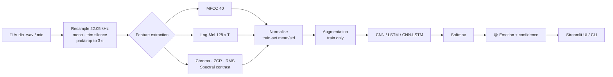

<div align="center">

# 🎙️ Audio Emotion / Speaker Mood Classification

### A Deep Learning Pipeline for Speech Emotion Recognition (SER) with a Live Streamlit Demo


**Upload or record a voice clip → get the speaker's emotion + confidence in real time.**

[Overview](#-overview) · [How it works](#-how-it-works) · [Datasets](#-datasets) · [Models](#-model-architectures) · [Results](#-results) · [Quick start](#-quick-start) · [Demo](#-streamlit-demo) · [Research](#-research-background) · [References](#-references)

</div>

---

## 📌 Table of Contents

1. [Overview](#-overview)
2. [Why this problem is hard](#-why-this-problem-is-hard)
3. [How it works](#-how-it-works)
4. [Datasets](#-datasets)
5. [Feature extraction](#-feature-extraction)
6. [Data augmentation](#-data-augmentation)
7. [Model architectures](#-model-architectures)
8. [Training strategy](#-training-strategy)
9. [Evaluation protocol](#-evaluation-protocol-important)
10. [Results](#-results)
11. [Project structure](#-project-structure)
12. [Quick start](#-quick-start)
13. [Streamlit demo](#-streamlit-demo)
14. [Research background & state of the art](#-research-background)
15. [Limitations & ethics](#-limitations--ethics)
16. [Roadmap](#-roadmap)
17. [References](#-references)
18. [Citation, License, Acknowledgements](#-citation)

---

## 🔍 Overview

**Speech Emotion Recognition (SER)** is the task of inferring a speaker's affective state (angry, happy, sad, calm …) from the *acoustic* properties of their voice — **how** something is said rather than **what** is said. It sits in the field of *computational paralinguistics* and powers applications such as:

| Domain | Use case |
|---|---|
| 📞 Call centres | Detect frustrated customers and escalate in real time |
| 🧠 Mental health | Passive mood tracking and early-warning signals (as an *assistive* signal, never a diagnosis) |
| 🤖 Voice assistants | Adapt tone and response to the user's mood |
| 🚗 Automotive | Driver stress / fatigue detection |
| 🎓 E-learning | Engagement and frustration monitoring |
| 🎮 Gaming / HCI | Emotion-aware characters and interfaces |

This repository provides an **end-to-end, reproducible deep-learning pipeline**:

```
Raw audio → preprocessing → feature extraction → augmentation → CNN / LSTM / CNN-LSTM → emotion + confidence → Streamlit app
```

### ✨ Key features

- 🎧 Classifies `.wav` audio into **8 emotions** (neutral, calm, happy, sad, angry, fearful, disgust, surprised)
- 🧩 Multiple architectures to compare: **1D-CNN, LSTM / BiLSTM, CNN-LSTM, (optional) Attention**
- 📊 Features: **MFCC, log-Mel spectrogram, Chroma, ZCR, RMS, spectral contrast**
- 🔁 Audio augmentation: noise, pitch shift, time stretch, time shift
- 🧪 **Speaker-independent evaluation** (no data leakage) alongside the usual random split
- 📈 Confusion matrix, per-class F1, UAR / WAR, training curves
- 🌐 **Streamlit web app**: upload a file *or* record from the microphone
- 🖥️ CLI prediction for scripting and batch use
- 🧱 Clean, modular code (`config → data → features → models → train → evaluate → predict`)

---

## ⚠️ Why this problem is hard

Emotion in speech is **subjective, ambiguous, and speaker-dependent**. Understanding this makes you a better practitioner:

1. **Label ambiguity** – Even humans disagree. Human accuracy on acted corpora is high, but on natural speech inter-annotator agreement is modest.
2. **Acted ≠ natural** – RAVDESS/TESS/EMO-DB contain *actors* performing emotions. Models trained on them often drop sharply on spontaneous, real-world speech.
3. **Speaker variability** – Pitch, accent, gender, age and recording conditions vary far more than emotion does. A model can silently learn *who* is speaking instead of *how they feel*.
4. **Small datasets** – A few thousand clips versus millions in ASR → overfitting is the default outcome.
5. **Class imbalance & confusable pairs** – e.g. *calm ↔ neutral*, *fear ↔ surprise*, *happy ↔ surprise*.
6. **Valence gap** – Acoustics capture **arousal** (calm vs. excited) well, but **valence** (positive vs. negative) poorly. Angry (high arousal, negative) vs. happy (high arousal, positive) is acoustically close.

---

## ⚙️ How it works



**Step by step**

1. **Load & standardise** – Resample to a fixed rate (22,050 Hz), convert to mono, trim leading/trailing silence, pad or crop to a fixed duration (3 s).
2. **Extract features** – Convert the waveform into a time-frequency representation that CNNs/LSTMs can learn from.
3. **Normalise** – Standardise using **training-set statistics only** (never fit the scaler on validation/test).
4. **Augment** – Only on the training split.
5. **Classify** – Neural network outputs class probabilities via softmax.
6. **Serve** – Predictions exposed through a CLI and a Streamlit interface.

---

## 🗂️ Datasets

| Dataset | Clips | Speakers | Emotions | Language | Type |
|---|---|---|---|---|---|
| **RAVDESS** (speech) | 1,440 | 24 actors (12 F / 12 M) | neutral, calm, happy, sad, angry, fearful, disgust, surprised | English (North American) | Acted |
| **TESS** | 2,800 | 2 actresses | 7 (no *calm*) | English | Acted |
| **CREMA-D** | 7,442 | 91 actors | 6 (no *calm*, *surprised*) | English | Acted, crowd-rated |
| **SAVEE** | 480 | 4 male speakers | 7 | English (British) | Acted |
| **EMO-DB** | 535 | 10 actors | 7 | German | Acted |
| **IEMOCAP** | ~12 h | 10 speakers | multi-class + dimensional | English | Dyadic, semi-natural |

> 💡 **Default in this repo:** RAVDESS (primary) with optional combination of TESS / CREMA-D / SAVEE for more data and cross-corpus tests.
> Datasets are **not** included in the repository because of licensing and size — see [Quick start](#-quick-start) for download links.

### RAVDESS filename convention

Each file name encodes 7 two-digit fields: `Modality-VocalChannel-Emotion-Intensity-Statement-Repetition-Actor.wav`

| Field | Values |
|---|---|
| Modality | 01 full-AV · 02 video-only · **03 audio-only** |
| Vocal channel | **01 speech** · 02 song |
| **Emotion** | 01 neutral · 02 calm · 03 happy · 04 sad · 05 angry · 06 fearful · 07 disgust · 08 surprised |
| Intensity | 01 normal · 02 strong (no strong for *neutral*) |
| Statement | 01 "Kids are talking by the door" · 02 "Dogs are sitting by the door" |
| Repetition | 01 · 02 |
| Actor | 01–24 (odd = male, even = female) |

Example: `03-01-05-01-02-01-12.wav` → audio-only, speech, **angry**, normal intensity, statement 2, repetition 1, actor 12 (female).

---

## 🎛️ Feature extraction

| Feature | Shape (3 s @ 22.05 kHz) | What it captures |
|---|---|---|
| **MFCC (40)** | 40 × ~130 | Compact spectral envelope — timbre / vocal tract shape |
| **Log-Mel spectrogram (128)** | 128 × ~130 | Perceptually-scaled energy; ideal "image" input for CNNs |
| **Chroma (12)** | 12 × T | Pitch-class energy |
| **ZCR** | 1 × T | Noisiness / voicing |
| **RMS energy** | 1 × T | Loudness / intensity (strongly tied to arousal) |
| **Spectral contrast (7)** | 7 × T | Peak–valley difference per sub-band |
| **Statistical summary** | 1-D vector | mean / std / min / max over time for classical ML baselines |

```python
import librosa, numpy as np

SR, DURATION, N_MELS, N_MFCC = 22050, 3.0, 128, 40

def load_audio(path):
    y, _ = librosa.load(path, sr=SR, mono=True)
    y, _ = librosa.effects.trim(y, top_db=30)
    target = int(SR * DURATION)
    return np.pad(y, (0, max(0, target - len(y))))[:target]

def log_mel(y):
    mel = librosa.feature.melspectrogram(y=y, sr=SR, n_mels=N_MELS, n_fft=2048, hop_length=512)
    return librosa.power_to_db(mel, ref=np.max)          # (128, T)

def mfcc(y):
    return librosa.feature.mfcc(y=y, sr=SR, n_mfcc=N_MFCC, n_fft=2048, hop_length=512)   # (40, T)
```

---

## 🔁 Data augmentation

Applied **only to the training set** and **after** the train/test split.

| Technique | Typical setting | Why it helps |
|---|---|---|
| Gaussian noise | SNR 15–30 dB | Robustness to microphone/background noise |
| Pitch shift | ±2 semitones | Invariance to speaker pitch |
| Time stretch | 0.85× – 1.15× | Invariance to speaking rate |
| Time shift | ±0.2 s | Position invariance |
| SpecAugment | 2 freq masks + 2 time masks | Strong regulariser for spectrogram models |
| Mixup (optional) | α = 0.2 | Smoother decision boundaries |

---

## 🧠 Model architectures

### 1. 1D-CNN on MFCC (baseline)

```
Input (T × 40) → [Conv1D(64) → BN → ReLU → MaxPool → Dropout] ×3 → GlobalAvgPool → Dense(128) → Dense(8, softmax)
```

### 2. LSTM / BiLSTM

```
Input (T × 40) → BiLSTM(128, return_sequences) → Dropout(0.3) → BiLSTM(64) → Dense(64) → Dense(8, softmax)
```
Captures long-range temporal dynamics (prosody evolving across the utterance).

### 3. CNN-LSTM (recommended hybrid)

```
Log-Mel (128 × T × 1)
 → [Conv2D → BN → ReLU → MaxPool(2×2) → Dropout] ×3      # local time-frequency patterns
 → Reshape (time-major)
 → LSTM(128) → Dropout(0.3)                               # temporal modelling
 → Dense(64, ReLU) → Dense(8, softmax)
```

### 4. (Optional) CNN-BiLSTM + Attention

Adds a self-attention / attention-pooling layer so the network can focus on the most emotionally salient frames (e.g. stressed syllables) rather than averaging uniformly.

### Minimal Keras reference

```python
from tensorflow.keras import layers, models

def build_cnn_lstm(input_shape=(128, 130, 1), n_classes=8):
    inp = layers.Input(shape=input_shape)
    x = inp
    for f in (32, 64, 128):
        x = layers.Conv2D(f, 3, padding="same", activation="relu")(x)
        x = layers.BatchNormalization()(x)
        x = layers.MaxPooling2D(2)(x)
        x = layers.Dropout(0.25)(x)
    # (freq, time, ch) -> (time, freq*ch)
    x = layers.Permute((2, 1, 3))(x)
    x = layers.Reshape((x.shape[1], x.shape[2] * x.shape[3]))(x)
    x = layers.LSTM(128)(x)
    x = layers.Dropout(0.3)(x)
    x = layers.Dense(64, activation="relu")(x)
    out = layers.Dense(n_classes, activation="softmax")(x)
    return models.Model(inp, out, name="cnn_lstm_ser")
```

### Why combine CNN + LSTM?

| Component | Strength | Weakness alone |
|---|---|---|
| CNN | Learns local spectral patterns, translation-invariant, fast | Limited temporal context |
| LSTM | Models sequence & prosody over time | Slow, overfits on small data, struggles with raw high-dim input |
| **CNN → LSTM** | Local pattern extraction **then** temporal reasoning | More hyper-parameters |

---

## 🏋️ Training strategy

| Setting | Value |
|---|---|
| Loss | Categorical cross-entropy (optionally with label smoothing 0.1) |
| Optimiser | Adam, lr = 1e-3 |
| Scheduler | `ReduceLROnPlateau` (factor 0.5, patience 5) |
| Early stopping | patience 12, restore best weights |
| Batch size | 32 |
| Epochs | up to 100 |
| Regularisation | Dropout 0.25–0.3, BatchNorm, L2 (1e-4), augmentation |
| Class imbalance | `class_weight="balanced"` |
| Seed | Fixed (`42`) for reproducibility |

---

## 🧪 Evaluation protocol (important)

> **A random train/test split of clips is misleading for SER.** The same actor appears in both splits, so the model can memorise *speaker identity* and "cheat". Reported accuracies of 90 %+ on RAVDESS often come from such leakage.

This project reports **two** numbers:

| Protocol | Split | Interpretation |
|---|---|---|
| **Random split** (stratified) | 80 / 10 / 10 by clip | Optimistic upper bound — comparable to many online tutorials |
| **Speaker-independent** ⭐ | Train actors 1–20, test unseen actors 21–24 (or leave-one-speaker-out) | Realistic generalisation to new voices |
| **Cross-corpus** (optional) | Train on RAVDESS → test on TESS / CREMA-D | Robustness to recording conditions |

**Metrics:** Accuracy, **UAR** (Unweighted Average Recall = macro recall), **WAR**, Macro-F1, per-class precision/recall, confusion matrix.

> 📝 *Community note:* repositories that evaluate on unseen actors typically report noticeably lower numbers (roughly 50–60 % on 8-class RAVDESS with MFCC-CNNs) than those using random splits (often 85–95 %). Both are valid — but they answer different questions.

---

## 📊 Results

> ⚠️ Fill this table with **your own** numbers after running `python src/evaluate.py`. Placeholders are intentionally left blank so no unverified figure is presented as fact.

### Random stratified split

| Model | Features | Accuracy | Macro-F1 | UAR |
|---|---|---|---|---|
| 1D-CNN | MFCC-40 | _TBD_ | _TBD_ | _TBD_ |
| BiLSTM | MFCC-40 | _TBD_ | _TBD_ | _TBD_ |
| **CNN-LSTM** | Log-Mel-128 | _TBD_ | _TBD_ | _TBD_ |
| CNN-BiLSTM + Attn | Log-Mel-128 | _TBD_ | _TBD_ | _TBD_ |

### Speaker-independent (unseen actors)

| Model | Features | Accuracy | Macro-F1 | UAR |
|---|---|---|---|---|
| 1D-CNN | MFCC-40 | _TBD_ | _TBD_ | _TBD_ |
| BiLSTM | MFCC-40 | _TBD_ | _TBD_ | _TBD_ |
| **CNN-LSTM** | Log-Mel-128 | _TBD_ | _TBD_ | _TBD_ |

### Artefacts produced

```
results/
├── confusion_matrix.png
├── training_curves.png
├── classification_report.txt
└── per_class_f1.png
```

### Typical error patterns to look for

- *Calm ↔ Neutral* (very similar low-arousal acoustics)
- *Fearful ↔ Surprised* and *Happy ↔ Surprised* (high-arousal confusions)
- *Disgust* is usually the hardest and most under-represented class

---

## 📁 Project structure

```
audio-emotion-classification/
├── README.md
├── requirements.txt
├── LICENSE
├── app.py                      # Streamlit demo
├── configs/
│   └── default.yaml            # sample rate, features, hyper-parameters
├── data/
│   ├── raw/                    # RAVDESS / TESS / ... (not tracked)
│   └── processed/              # cached .npy features
├── notebooks/
│   ├── 01_eda.ipynb            # waveform, spectrogram, class balance
│   ├── 02_features.ipynb
│   └── 03_experiments.ipynb
├── src/
│   ├── config.py               # constants, label maps
│   ├── datasets.py             # filename → label parsing, splits
│   ├── features.py             # MFCC / log-Mel / chroma extraction
│   ├── augment.py              # noise, pitch, stretch, SpecAugment
│   ├── models.py               # CNN, LSTM, CNN-LSTM, Attention
│   ├── train.py                # training loop + callbacks
│   ├── evaluate.py             # metrics + plots
│   └── predict.py              # single-file / batch inference
├── models/                     # saved weights (.keras / .h5 / .pth)
├── results/                    # figures & reports
└── tests/
    └── test_features.py
```

---

## 🚀 Quick start

### 1. Clone & install

```bash
git clone https://github.com/<your-username>/audio-emotion-classification.git
cd audio-emotion-classification

python -m venv .venv
source .venv/bin/activate          # Windows: .venv\Scripts\activate
pip install -r requirements.txt
```

`requirements.txt`

```
numpy
pandas
scikit-learn
librosa
soundfile
tensorflow>=2.13
matplotlib
seaborn
streamlit
sounddevice          # optional: microphone recording
pyyaml
tqdm
```

> 🔧 `librosa` may need `ffmpeg` / `libsndfile` on some systems (`sudo apt install ffmpeg libsndfile1`).

### 2. Download data

| Dataset | Source |
|---|---|
| RAVDESS | https://www.kaggle.com/datasets/uwrfkaggler/ravdess-emotional-speech-audio |
| TESS | Kaggle: *Toronto emotional speech set (TESS)* |
| CREMA-D | Kaggle / official GitHub: *CheyneyComputerScience/CREMA-D* |
| SAVEE | University of Surrey SAVEE database |

Place them like so:

```
data/raw/RAVDESS/Actor_01/03-01-01-01-01-01-01.wav
data/raw/RAVDESS/Actor_02/...
```

### 3. Train

```bash
# default: CNN-LSTM on log-Mel
python src/train.py --model cnn_lstm

# other options
python src/train.py --model cnn          # 1D-CNN on MFCC
python src/train.py --model lstm         # BiLSTM on MFCC
python src/train.py --model cnn_lstm --datasets ravdess tess --augment
python src/train.py --model cnn_lstm --split speaker      # speaker-independent
```

### 4. Evaluate

```bash
python src/evaluate.py --model models/cnn_lstm.keras --split speaker
```

### 5. Predict (CLI)

```bash
python src/predict.py "data/raw/RAVDESS/Actor_21/03-01-05-01-01-01-21.wav" --model models/cnn_lstm.keras
# → Emotion: angry   Confidence: 0.87
```

---

## 🌐 Streamlit demo

```bash
streamlit run app.py
```

**What you get**

- 📤 Upload `.wav` / `.mp3` or 🎙️ record from the microphone
- 🔊 Audio playback and **waveform + spectrogram** visualisation
- 🏷️ Predicted emotion with an emoji and **confidence bar chart over all classes**
- 🔀 Model selector (CNN / LSTM / CNN-LSTM)
- ⏱️ Inference latency display

**Demo flow**

```
[Upload / Record]  →  [Waveform & Mel-spectrogram]  →  [😠 Angry — 87 %]  →  [Probability bars]
```

---

## 🔬 Research background

### Evolution of SER

| Era | Approach | Notes |
|---|---|---|
| **Classical (≤2014)** | Hand-crafted features (openSMILE / eGeMAPS) + SVM / GMM / HMM | Strong baselines, interpretable |
| **Deep features (2014–2019)** | CNN / LSTM / CNN-LSTM on MFCC or spectrograms | What this repo implements |
| **Attention & Transformers (2019–2021)** | Self-attention, multi-head attention pooling | Better temporal weighting |
| **Self-supervised foundation models (2021–now)** | **wav2vec 2.0, HuBERT, WavLM, emotion2vec** fine-tuned / used as frozen encoders | Current state of the art |
| **Multimodal & LLM era** | Audio + text + video fusion; audio-LLMs | Helps with valence |

### What the literature says

- **Fine-tuning wav2vec 2.0** on IEMOCAP was shown to beat earlier state-of-the-art, and task-adaptive pre-training improved it further, especially in low-resource settings (Chen & Rudnicky, 2021).
- **Transformer-based foundation models** (wav2vec 2.0, HuBERT) were shown to close much of the long-standing *valence gap* in dimensional SER (Wagner et al., 2022).
- **emotion2vec**, a universal emotion representation, reportedly outperforms other self-supervised models on IEMOCAP even with only linear downstream layers, and generalises across languages and related tasks (Ma et al., 2023/2024).
- **Evaluation reality check**: comparisons across papers are often unfair because of inconsistent splits, label merging and metrics; standardised protocols are needed (Antoniou et al., 2023).

### Where this project sits

```
Accuracy / generalisation
 ▲
 │                                     ● wav2vec2 / HuBERT / emotion2vec (pre-trained)
 │                        ● CNN-LSTM + attention
 │             ● CNN-LSTM (this repo)
 │      ● CNN / LSTM (this repo)
 │  ● SVM + hand-crafted features
 └────────────────────────────────────────────► Model complexity / data needs
```

This repo is a **learning-friendly, from-scratch baseline** designed to teach the full pipeline. For production-grade accuracy on real-world speech, upgrade to a pre-trained encoder (see [Roadmap](#-roadmap)).

---

## ⚖️ Limitations & ethics

- **Acted data bias** – Models trained on actors may not generalise to spontaneous speech.
- **Cultural & linguistic variation** – Emotional expression differs across cultures and languages; most corpora here are English/German.
- **Gender & accent bias** – Always audit per-group performance before any deployment.
- **Not a lie/mental-health detector** – Outputs are *probabilistic estimates of expressed emotion*, not a person's true inner state.
- **Privacy & consent** – Voice is biometric data. Obtain informed consent, minimise retention, and comply with local regulation (e.g. GDPR / India's DPDP Act).
- **High-stakes use** (hiring, policing, medical decisions) is **strongly discouraged** without rigorous validation and human oversight.

---

## 🗺️ Roadmap

- [x] MFCC + CNN / LSTM baselines
- [x] CNN-LSTM on log-Mel
- [x] Streamlit demo with mic recording
- [ ] Speaker-independent cross-validation (leave-one-actor-out)
- [ ] Attention pooling / Transformer encoder
- [ ] **Fine-tune wav2vec 2.0 / HuBERT / WavLM** (Hugging Face `transformers`)
- [ ] **emotion2vec** frozen-encoder + linear head
- [ ] Cross-corpus evaluation (RAVDESS → TESS / CREMA-D / IEMOCAP)
- [ ] Hindi / Hinglish emotion corpora support
- [ ] Real-time streaming inference (sliding window)
- [ ] Model export: ONNX / TensorFlow Lite for mobile & edge
- [ ] Docker image + Hugging Face Spaces deployment
- [ ] Explainability: Grad-CAM on spectrograms, SHAP on features

---

## 📚 References

**Datasets**
1. Livingstone, S. R., & Russo, F. A. (2018). *The Ryerson Audio-Visual Database of Emotional Speech and Song (RAVDESS).* PLoS ONE, 13(5).
2. Pichora-Fuller, M. K., & Dupuis, K. (2020). *Toronto Emotional Speech Set (TESS).* University of Toronto Dataverse.
3. Cao, H. et al. (2014). *CREMA-D: Crowd-sourced Emotional Multimodal Actors Dataset.* IEEE Trans. Affective Computing.
4. Burkhardt, F. et al. (2005). *A Database of German Emotional Speech (EMO-DB).* Interspeech.
5. Busso, C. et al. (2008). *IEMOCAP: Interactive Emotional Dyadic Motion Capture Database.* Language Resources and Evaluation.

**Methods**
6. Baevski, A. et al. (2020). *wav2vec 2.0: A Framework for Self-Supervised Learning of Speech Representations.* NeurIPS.
7. Hsu, W.-N. et al. (2021). *HuBERT: Self-Supervised Speech Representation Learning by Masked Prediction of Hidden Units.* IEEE/ACM TASLP.
8. Chen, L.-W., & Rudnicky, A. (2021). *Exploring Wav2vec 2.0 Fine-Tuning for Improved Speech Emotion Recognition.* arXiv:2110.06309.
9. Wagner, J. et al. (2022). *Dawn of the Transformer Era in Speech Emotion Recognition: Closing the Valence Gap.* arXiv:2203.07378.
10. Ma, Z. et al. (2023). *emotion2vec: Self-Supervised Pre-Training for Speech Emotion Representation.* arXiv:2312.15185.
11. Antoniou, N. et al. (2023). *Designing and Evaluating Speech Emotion Recognition Systems: A Reality Check Case Study with IEMOCAP.* arXiv:2304.00860.
12. Park, D. S. et al. (2019). *SpecAugment: A Simple Data Augmentation Method for ASR.* Interspeech.
13. McFee, B. et al. *librosa: Audio and Music Signal Analysis in Python.* SciPy 2015.

**Related open-source implementations (for comparison & inspiration)**
- `SUMAIRDERO7/speech-emotion-recognition` — CNN-LSTM, log-Mel, Streamlit
- `deepak-kalyani/speech_emotion` — PyTorch CNN+LSTM, RAVDESS + TESS, live recording
- `adarshkasaudhan774-spec/CodeAlpha_Speech_Emotion_Recognition` — CNN / LSTM / CNN-LSTM with unseen-actor evaluation
- `ananthikaanu5-arch/Emotion-Recognition-from-speech-` — multi-dataset, multi-model
- `souradeepdutta/Speech-Emotion-Recognition-with-CNN-LSTM-CLSTM` — four-dataset Kaggle notebook
- `Talebxg7/speech-emotion-recognition-dl` — CNN + BiLSTM + Autoencoder + Attention
- `Hannibal0420/Speech-Emotion-Recognition-TinyML` — TFLite quantisation for edge devices

---

## 📝 Citation

If this project helps your work, please cite:

```bibtex
@software{audio_emotion_classification,
  author  = {<Your Name>},
  title   = {Audio Emotion / Speaker Mood Classification: A Deep Learning Pipeline with Streamlit Demo},
  year    = {2026},
  url     = {https://github.com/<your-username>/audio-emotion-classification}
}
```

## 📄 License

Released under the **MIT License**. Dataset licences belong to their respective owners — check each dataset's terms before redistribution or commercial use.

## 🙏 Acknowledgements

RAVDESS, TESS, CREMA-D, SAVEE, EMO-DB and IEMOCAP authors · the `librosa`, TensorFlow, PyTorch, Hugging Face and Streamlit communities · all open-source SER repositories listed above.

---

<div align="center">

⭐ **If you found this useful, star the repo!** ⭐

*Built with ❤️ for the deep learning & audio community.*

</div>
